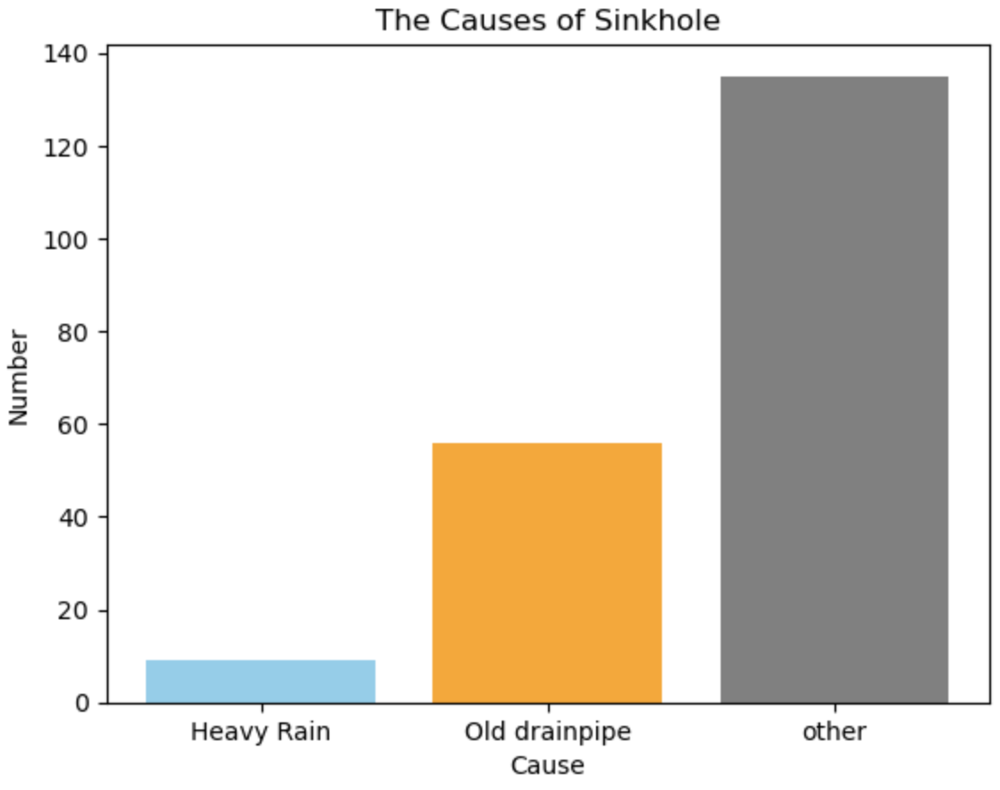
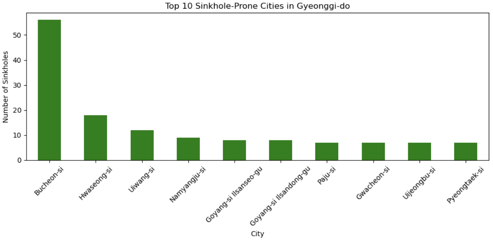

# Sinkhole Pattern Analysis in Gyeonggi-do

A Python-based data analysis project investigating sinkhole occurrences in Gyeonggi-do, South Korea, using public data from the Gyeonggi Data Dream Open API.

The project focuses on collecting and processing 200 sinkhole records, examining major causes of ground subsidence, and comparing occurrence frequencies across cities.

## Project Overview

- **Dataset:** 200 sinkhole records
- **Region:** Gyeonggi-do, South Korea
- **Data Source:** Gyeonggi Data Dream Open API
- **Language:** Python
- **Focus:** API integration, XML parsing, data analysis, and visualization

## Key Features

### 1. Data Collection and Processing
- Retrieve sinkhole occurrence records through the Gyeonggi Data Dream Open API.
- Use Requests to send HTTP requests and BeautifulSoup to parse XML responses.
- Extract occurrence dates, locations, regional information, and reported causes.
- Organize collected records into Pandas DataFrames.

### 2. Cause Analysis
- Examine reported causes of ground subsidence.
- Identify records associated with heavy rainfall and drainage infrastructure.
- Calculate occurrence counts for different cause categories.

### 3. Regional Analysis
- Group sinkhole occurrences by city using Pandas.
- Compare occurrence frequencies across regions.
- Prepare bar-chart visualizations using Matplotlib.

## Analysis Results

### 1. Sinkhole Causes



### 2. Sinkhole Occurrences by City



## Technologies Used

| Technology | Purpose |
|---|---|
| Python | Data processing and analysis |
| Requests | Open API integration |
| BeautifulSoup | XML parsing |
| Pandas | Data organization and aggregation |
| Matplotlib | Data visualization |

## Getting Started

### 1. Clone the repository

```bash
git clone https://github.com/Jjeongha/2025_Python-Data-Analysis-Research.git
cd 2025_Python-Data-Analysis-Research
```

### 2. Install dependencies

```bash
pip install pandas requests beautifulsoup4 lxml matplotlib
```

### 3. Configure the API key

Obtain an API key from the Gyeonggi Data Dream platform and set it as an environment variable.

**macOS / Linux:**

```bash
export API_KEY="YOUR_API_KEY"
```

**Windows PowerShell:**

```powershell
$env:API_KEY="YOUR_API_KEY"
```

Do not commit API keys or `.env` files to the repository.

### 4. Run the analysis

```bash
python sinkhole_analysis.py
```

**Note:** The current implementation requires minor constructor fixes before it can run successfully. The visualization examples are also currently commented out.

## Data Source

**Gyeonggi Data Dream — Ground Subsidence Information**

[Official Dataset](https://data.gg.go.kr/portal/data/service/selectServicePage.do?infId=QSTW4UZ6TA3GC2IISNFR25936537&infSeq=2)

The script requests up to 200 records through four paginated API requests.

## Future Improvements

- Improve API response validation and error handling.
- Automate the generation of analysis charts.
- Add unit tests for data collection and aggregation.
- Support configurable pagination and dataset sizes.

## Author

**Jeongha Chung**

[GitHub](https://github.com/Jjeongha)
